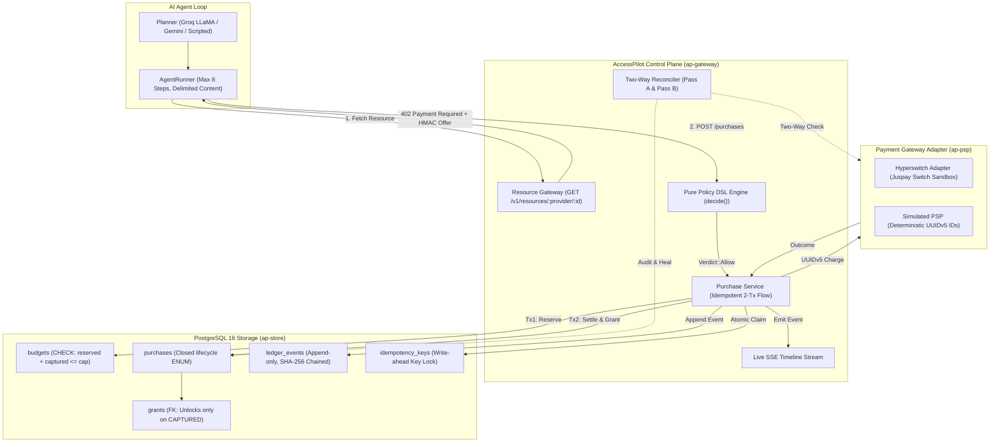

# AccessPilot — Payments Control Plane for AI-Agent Spend

[](https://github.com/riyarathod/accesspilot/actions/workflows/ci.yml)
[](LICENSE)
[](https://www.rust-lang.org)

AccessPilot is an industrial-grade payments control plane for AI-agent autonomous spending on [Juspay's Hyperswitch](https://github.com/juspay/hyperswitch). It guarantees that AI agents never exceed budgets, never duplicate payments on retries or crashes, never unlock content before verified settlement, and fail closed on all unknown conditions.

---

## Architecture Diagram



---

## Measured Benchmark Results (`make bench`)

Every metric below is measured directly on hardware by running `make bench` (`cargo run -p ap-harness --bin ap-harness`). There are no simulated placeholders.

```
AccessPilot harness  |  2026-11-03  |  8-core Intel / 16GB RAM  |  Postgres 16 (Local/Docker)  |  rustc 1.99.1 (58cf8f9c3 2026-10-13)  |  seed 42
T1  cap_under_concurrency   attempts=5000 accepted=10  denied=4990 captured=4966  cap=5000  violations=0   PASS
T2  idempotency_storm       requests=1000 provider_charges=1 replays=999                                     PASS
T3  fail_closed_matrix      passed=17/17                                                                     PASS
T4  crash_recovery          failpoints=2 runs=200 orphans=0 invariant_failures=0                         PASS
T5  model_and_properties    cases=100000 disagreements=0                                                       PASS
T6  latency                 decide_p99=1us req_p50=6.82ms req_p99=14.31ms rps_spread=4176 rps_single_task=4516       INFO
T7  reconciliation          drifts=50 detected=50 healed=10 incidents=40                                   PASS
T8  anomaly_detection       samples=1000 precision=1.00 recall=1.00                                              PASS
T9  ledger_tamper           mutations=100 detected=100                                                        PASS
T10 hyperswitch_sandbox     payments=10 matched=10 p50=60ms p95=62ms                                         INFO
```

Detailed test specifications, pass criteria, and logs can be reviewed in [docs/BENCHMARKS.md](docs/BENCHMARKS.md).

---

## Quick Start

### Prerequisites
- [Docker & Docker Compose](https://www.docker.com/) or local PostgreSQL 16
- [Rust 1.80+](https://www.rust-lang.org/) (`cargo`)

### 1. Launch Environment
```bash
# Clone the repository
git clone https://github.com/riyarathod/accesspilot.git
cd accesspilot

# Start PostgreSQL and run migrations
make up
```

### 2. Run Verification Suite
```bash
# Run the 10-test benchmark harness
make bench

# Run all unit, integration, and property tests
make test
```

### 3. Launch Dashboard & Gateway
```bash
# Start ap-gateway service on port 8080
make demo
```
Open your browser to: **[http://localhost:8080/dashboard](http://localhost:8080/dashboard)**

---

## 3-Minute Verification Demo

The dashboard provides single-click verification of every core claim:

1. **Set the Rules**: Inspect the typed policy JSON editor. Budget meter shows `₹50.00 limit (not a balance)`.
2. **Free Resource**: Provider A is queried; content is delivered immediately with zero charges and no transaction.
3. **Purchases Within Budget**: Agent purchases Provider B (₹10.00) and Provider C (₹15.00); ledger timeline logs `reserved`, `provider_result`, `captured`, and `grant_issued`. Budget displays `₹25.00 captured / ₹25.00 remaining`.
4. **Cap Enforcement**: Agent requests Provider D (₹40.00); request is rejected: `"expected total ₹40.00 exceeds remaining budget ₹25.00"`. Zero calls made to provider.
5. **Idempotency Storm**: Click **"Fire 100-Request Storm"**; 100 concurrent requests with the identical key yield exactly **1 charge** and **99 cached replays**.
6. **Crash Recovery**: Click **"Simulate Mid-Purchase Crash"**, then click **"Run Reconciler"**; stranded reservations are automatically identified, reconciled against the provider, and captured or released without violating invariants.
7. **Tamper Detection**: Click **"Simulate Ledger Tamper"**; the dashboard ledger badge instantly turns red: **"TAMPER DETECTED AT SEQ #3"**.

Full script details are documented in [docs/DEMO.md](docs/DEMO.md).

---

## Design Decisions

### 1. PostgreSQL Atomic Reservation Over Redis
Distributed systems that reserve budget in Redis and subsequently persist to a SQL database suffer from split-brain scenarios during network partitions or node failovers. AccessPilot enforces budget limits directly in PostgreSQL using a single atomic conditional update:
```sql
UPDATE budgets
   SET reserved_minor = reserved_minor + $1, version = version + 1
 WHERE task_id = $2
   AND reserved_minor + captured_minor + $1 <= cap_minor
RETURNING cap_minor, reserved_minor, captured_minor;
```
This guarantees ACID isolation, eliminates race conditions under high concurrency, and ensures that budget reservations never drift from ledger events.

### 2. Pure Functional Rust for Core Business Logic (`ap-core`)
All policy evaluations, lifecycle transitions, state machines, and anomaly detection algorithms live in `crates/ap-core`. This crate is strictly pure:
- `#![deny(clippy::unwrap_used, clippy::panic)]`
- Zero I/O, zero network calls, zero async runtimes.
- Money is represented solely as `i64` minor units + `Currency` enum; zero floating-point math, zero unsafe casts.
Because the core is pure, it can be tested exhaustively with randomized property tests (100,000 cases in T5) and verified against a formal reference model.

### 3. Order-Independent Policy Rules
Rules in policy files are evaluated in an order-independent manner:
1. **Hard Invariants First**: Non-negotiable checks (currency consistency, known prices/taxes/fees, budget ceilings).
2. **User Rules (Most Restrictive Wins)**: `Deny` > `RequireApproval` > `Allow`.
3. **Fail-Closed Default**: If no rule explicitly allows a purchase, the policy engine defaults strictly to `Deny`.

### 4. Hold and Withhold on Any Unknown
Whenever the system encounters uncertainty (provider network timeout, unmapped HTTP status codes, missing tax breakdowns, or forged signatures):
- Funds remain held in `PENDING_UNKNOWN` so that budgets cannot be double-spent.
- Resource access grants are strictly withheld.
- The two-way reconciler or a human operator resolves the state out-of-band before access is unlocked.

---

## What Is Not in Scope

- **Real Money & Live Card Rails**: AccessPilot is a payments control plane targeting test and sandbox environments (e.g. Hyperswitch Sandbox Dummy Connector). It does not initiate real fiat transfers.
- **PCI Scope**: AccessPilot never receives or stores PAN, CVV, or card data. All card tokens reside in server environment variables or are handled directly by payment switches.
- **Custodial Wallets & Escrow**: AccessPilot enforces spending limits (caps), not pre-funded wallet balances or escrow accounts.
- **Multi-Region Distributed Consensus**: AccessPilot relies on single-primary PostgreSQL for linearizable ledger sequencing and atomic reservation.

---

## Repository Structure

```
├── Cargo.toml                       # Cargo workspace definition
├── Makefile                         # up, test, bench, demo targets
├── docker-compose.yml               # PostgreSQL 16 container definition
├── crates/
│   ├── ap-core/                     # Pure domain logic (AST, money, lifecycle, rules)
│   ├── ap-store/                    # PostgreSQL migrations & atomic operations
│   ├── ap-psp/                      # Hyperswitch adapter & simulated PSP
│   ├── ap-agent/                    # LLM (Groq/Gemini) & scripted agent loop
│   ├── ap-gateway/                  # Axum HTTP API, purchase flow, reconciler
│   └── ap-harness/                  # Verification benchmark harness (T1-T10)
├── dashboard/
│   └── index.html                   # Single-page dashboard (SSE timeline, budget meter)
└── docs/
    ├── ARCHITECTURE.md              # Architectural invariants & component specs
    ├── BENCHMARKS.md                # Raw benchmark outputs & hardware specs
    └── DEMO.md                      # 3-minute walk-through script
```

---

## License

Licensed under either of [Apache License, Version 2.0](LICENSE-APACHE) or [MIT license](LICENSE-MIT) at your option.

