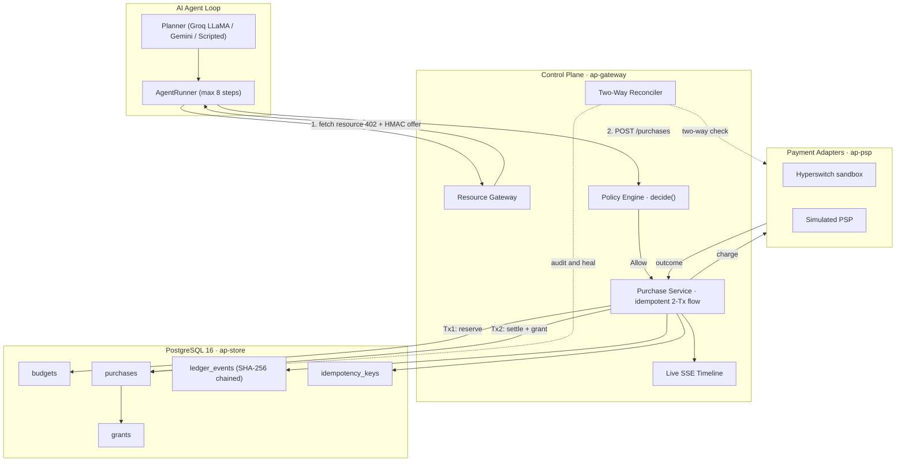

<div align="center">

# 🛩️ AccessPilot

### A payments control plane that lets AI agents spend money without ever overspending, double-charging, or unlocking before settlement.

Built in Rust on top of [Juspay Hyperswitch](https://github.com/juspay/hyperswitch) · PostgreSQL 16 · Fail-closed by design

[](https://github.com/riyarathod/accesspilot/actions/workflows/ci.yml)
[](#license)
[](https://www.rust-lang.org)
[](CONTRIBUTING.md)
[](https://github.com/riyarathod/accesspilot/labels/good%20first%20issue)

[**Quick Start**](#-quick-start) · [**Demo**](#-3-minute-demo) · [**Benchmarks**](#-benchmarks) · [**Architecture**](#-architecture) · [**Contributing**](#-contributing) · [**Roadmap**](#-roadmap)

<!-- Add a 10–15 second GIF of the dashboard here: the budget meter filling, the 100-request storm, and the red TAMPER DETECTED badge. -->
<!--  -->

</div>

---

## Why AccessPilot?

AI agents are starting to buy things: API calls, datasets, paywalled content. But an agent that retries, crashes, or hallucinates a price can drain a budget in seconds, and a naive "check balance, then charge" flow breaks under concurrency.

AccessPilot sits between your agent and the payment provider and enforces four guarantees:

| Guarantee | What it means |
|---|---|
| 💰 **Never exceed the budget** | Reservations are one atomic PostgreSQL update, so concurrent agents cannot race past the cap. |
| 🔁 **Never pay twice** | Write-ahead idempotency keys mean retries and crashes produce one provider charge. |
| 🔒 **Never unlock early** | Content access is granted only after a verified `CAPTURED` settlement. |
| 🛑 **Fail closed on the unknown** | Timeouts, unmapped statuses and forged signatures hold the funds and withhold access until reconciled. |

> **Status:** AccessPilot targets sandbox and test environments (Hyperswitch Dummy Connector). It does not move real money. See [What's not in scope](#-whats-not-in-scope).

---

## ✨ Features

- **Atomic budget reservation** in PostgreSQL with a `CHECK (reserved + captured <= cap)` constraint as a second line of defense
- **Idempotent two-transaction purchase flow** (reserve → charge → settle and grant)
- **Pure policy engine** with an order-independent DSL: `Deny` > `RequireApproval` > `Allow`, default `Deny`
- **HTTP 402 resource gateway** with HMAC-signed offers for agent-readable paywalls
- **Two-way reconciler** that audits local state against the provider and heals or escalates drift
- **Tamper-evident ledger**: append-only events chained with SHA-256
- **Live dashboard** with an SSE timeline, budget meter and one-click failure simulations
- **Pluggable PSP adapters**: Hyperswitch sandbox, or a deterministic simulated PSP for tests
- **Agent loop included**: scripted, Groq LLaMA or Gemini planners with an 8-step cap

---

## 🚀 Quick Start

**Requirements:** [Docker](https://www.docker.com/) (or local PostgreSQL 16) and [Rust 1.80+](https://www.rust-lang.org/)

```bash
git clone https://github.com/riyarathod/accesspilot.git
cd accesspilot

make up       # start PostgreSQL and run migrations
make test     # unit, integration and property tests
make bench    # 10-test verification harness (T1–T10)
make demo     # start the gateway on :8080
```

Then open **http://localhost:8080/dashboard**.

---

## 🎬 3-Minute Demo

Every core claim can be verified from the dashboard with one click:

1. **Set the rules.** Edit the typed policy JSON. The meter shows `₹50.00 limit (not a balance)`.
2. **Free resource.** Provider A is delivered instantly, with no charge and no transaction.
3. **Purchases within budget.** The agent buys B (₹10) and C (₹15). The ledger shows `reserved → provider_result → captured → grant_issued`.
4. **Cap enforcement.** Provider D (₹40) is rejected: `expected total ₹40.00 exceeds remaining budget ₹25.00`. The provider is never called.
5. **Idempotency storm.** Fire 100 concurrent requests with one key: exactly **1 charge** and **99 cached replays**.
6. **Crash recovery.** Simulate a mid-purchase crash, run the reconciler, and watch stranded reservations get captured or released.
7. **Tamper detection.** Edit a ledger row and the badge turns red: `TAMPER DETECTED AT SEQ #3`.

Full walkthrough: [docs/DEMO.md](docs/DEMO.md)

---

## 📊 Benchmarks

Run `make bench` to reproduce. Results below are from an 8-core Intel / 16 GB machine, PostgreSQL 16 (Docker), rustc 1.99.1, seed 42.

| Test | What it checks | Result |
|---|---|---|
| **T1** Cap under concurrency | 5,000 concurrent purchase attempts against a ₹5,000 cap | **0 cap violations** |
| **T2** Idempotency storm | 1,000 requests, same key | **1 provider charge**, 999 replays |
| **T3** Fail-closed matrix | 17 unknown or hostile conditions | **17 / 17** denied or held |
| **T4** Crash recovery | 200 runs across 2 failpoints | **0 orphans, 0 invariant failures** |
| **T5** Model and property tests | 100,000 random cases vs a reference model | **0 disagreements** |
| **T6** Latency | Policy `decide()` / full request | p99 **1 µs** / p50 **6.8 ms**, p99 **14.3 ms** (~4.2k req/s) |
| **T7** Reconciliation | 50 injected state drifts | **50 / 50 detected**, 10 auto-healed, 40 escalated |
| **T8** Anomaly detection | 1,000 synthetic samples | precision 1.00, recall 1.00 |
| **T9** Ledger tamper | 100 row mutations | **100 / 100 detected** |
| **T10** Hyperswitch sandbox | 10 real sandbox payments | **10 / 10 matched**, p95 62 ms |

Pass criteria, raw logs and hardware notes: [docs/BENCHMARKS.md](docs/BENCHMARKS.md). T8 uses synthetic data, so treat it as a regression check, not a production accuracy claim.

---

## 🏗️ Architecture



### Design decisions

<details>
<summary><b>1. PostgreSQL atomic reservation instead of Redis</b></summary>

Reserving in Redis and persisting to SQL later risks split-brain during failovers. AccessPilot enforces the cap in one conditional update:

```sql
UPDATE budgets
   SET reserved_minor = reserved_minor + $1, version = version + 1
 WHERE task_id = $2
   AND reserved_minor + captured_minor + $1 <= cap_minor
RETURNING cap_minor, reserved_minor, captured_minor;
```

If zero rows are updated, the purchase is denied. There is no window between "check" and "reserve".
</details>

<details>
<summary><b>2. A pure Rust core (<code>ap-core</code>)</b></summary>

Policy evaluation, lifecycle transitions and anomaly detection live in a crate with `#![deny(clippy::unwrap_used, clippy::panic)]`, no I/O, no network and no async runtime. Money is `i64` minor units plus a `Currency` enum, with no floats. Purity is what makes 100,000-case property testing against a reference model possible.
</details>

<details>
<summary><b>3. Order-independent policy rules</b></summary>

Hard invariants run first (currency consistency, known prices, taxes and fees, budget ceilings). User rules then resolve as most-restrictive-wins: `Deny` > `RequireApproval` > `Allow`. If nothing explicitly allows, the answer is `Deny`.
</details>

<details>
<summary><b>4. Hold and withhold on any unknown</b></summary>

On a timeout, unmapped status, missing tax breakdown or forged signature, funds stay in `PENDING_UNKNOWN` so the budget cannot be double-spent, access is withheld, and the reconciler or a human resolves the state before anything unlocks.
</details>

---

## 🗂️ Repository Structure

```
accesspilot/
├── crates/
│   ├── ap-core/       # Pure domain logic: money, lifecycle, policy rules
│   ├── ap-store/      # PostgreSQL migrations and atomic operations
│   ├── ap-psp/        # Hyperswitch adapter and simulated PSP
│   ├── ap-agent/      # Scripted / Groq / Gemini agent loop
│   ├── ap-gateway/    # Axum HTTP API, purchase flow, reconciler
│   └── ap-harness/    # Benchmark harness (T1–T10)
├── dashboard/         # Single-page dashboard (SSE timeline, budget meter)
├── docs/              # ARCHITECTURE.md, BENCHMARKS.md, DEMO.md
├── Makefile           # up, test, bench, demo
└── docker-compose.yml # PostgreSQL 16
```

New here? Start with [`ap-core`](crates/ap-core). It has no I/O and is the easiest crate to read.

---

## 🚫 What's Not in Scope

- **Real money.** Sandbox and test rails only (Hyperswitch Dummy Connector).
- **PCI scope.** AccessPilot never sees PAN, CVV or card data.
- **Wallets and escrow.** It enforces spending *caps*, not pre-funded balances.
- **Multi-region consensus.** It relies on a single-primary PostgreSQL for linearizable sequencing.

AccessPilot is an independent project and is not affiliated with or endorsed by Juspay.

---

## 🗺️ Roadmap

- [ ] More PSP adapters (Stripe test mode, Razorpay test mode)
- [ ] Per-provider and per-category budgets
- [ ] Policy DSL linter and dry-run mode
- [ ] Prometheus metrics and OpenTelemetry traces
- [ ] Ledger anchoring (periodic hash checkpoints to external storage)
- [ ] Python and TypeScript client SDKs
- [ ] Multi-agent budget delegation (parent budget → child budgets)
- [ ] Dashboard dark mode and approval inbox for `RequireApproval` verdicts

Have an idea? [Open a discussion](https://github.com/riyarathod/accesspilot/discussions).

---

## 🤝 Contributing

**Contributions are very welcome, whether it's your first Rust PR or your fiftieth.**

### Ways to help

| If you like... | Try this |
|---|---|
| 🧪 Testing and breaking things | Add a failure case to the T3 fail-closed matrix or a new crash failpoint to T4 |
| 🦀 Rust | Add a policy rule type, or improve error types in `ap-core` |
| 🔌 Integrations | Write a new PSP adapter in `ap-psp` |
| 📝 Docs | Improve `docs/ARCHITECTURE.md`, add diagrams, fix typos |
| 🎨 Frontend | Polish the dashboard, add dark mode |
| 🔐 Security | Review the idempotency and reconciler logic and report issues |

### Getting started

1. Browse [**good first issues**](https://github.com/riyarathod/accesspilot/labels/good%20first%20issue) or [**help wanted**](https://github.com/riyarathod/accesspilot/labels/help%20wanted).
2. Comment on the issue so nobody duplicates work.
3. Fork, branch, and make your change:
   ```bash
   make up
   cargo fmt --all && cargo clippy --all-targets -- -D warnings
   make test
   make bench   # if you touched the purchase flow, store or reconciler
   ```
4. Open a PR describing *what* changed and *why*. We review quickly and are friendly to newcomers.

### Ground rules

- **Invariants are sacred.** A PR that weakens a guarantee (budget cap, idempotency, fail-closed) needs a test proving the guarantee still holds.
- **Keep `ap-core` pure.** No I/O, no async, no `unwrap`/`panic`.
- **Money is integers.** No floating point anywhere near amounts.
- **Add tests.** New behavior needs a unit or property test.

Please read [CONTRIBUTING.md](CONTRIBUTING.md) and our [Code of Conduct](CODE_OF_CONDUCT.md). Found a vulnerability? Please report it privately via [SECURITY.md](SECURITY.md) instead of a public issue.

---

## 💬 Community and Support

- 🐛 **Bugs and features:** [GitHub Issues](https://github.com/riyarathod/accesspilot/issues)
- 💡 **Questions and ideas:** [GitHub Discussions](https://github.com/riyarathod/accesspilot/discussions)
- ⭐ **Like the project?** A star helps others find it.

---

## 🙏 Acknowledgments

Built on [Juspay Hyperswitch](https://github.com/juspay/hyperswitch), with [Axum](https://github.com/tokio-rs/axum), [SQLx](https://github.com/launchbadge/sqlx) and PostgreSQL.

## License

Dual-licensed under [Apache 2.0](LICENSE-APACHE) or [MIT](LICENSE-MIT), at your option. Unless you state otherwise, any contribution you submit is dual-licensed the same way.
