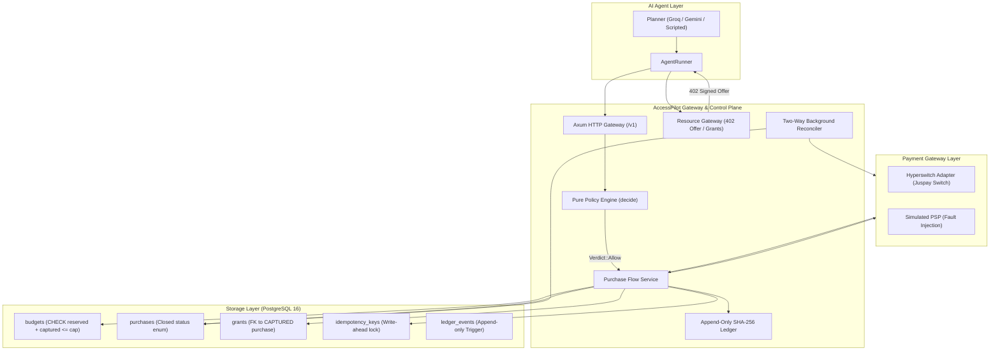

# AccessPilot — Payments Control Plane Architecture

AccessPilot is an industrial-grade payments control plane for AI-agent autonomous spending on Juspay's Hyperswitch. It prevents overspending, duplicate charges, unverified content access, and data drift through atomic budget reservation, deterministic retry IDs, a pure policy engine, and a hash-chained audit ledger.

---

## 1. System Architecture



---

## 2. Core Architectural Invariants

1. **Atomic Budget Reservation**:
   Every purchase attempt must first atomically reserve budget directly in PostgreSQL using a single statement with concurrency check:
   ```sql
   UPDATE budgets
      SET reserved_minor = reserved_minor + $1, version = version + 1
    WHERE task_id = $2
      AND currency = $3
      AND reserved_minor + captured_minor + $1 <= cap_minor
   RETURNING cap_minor, reserved_minor, captured_minor;
   ```
   No database transaction is ever held open across an external network call.

2. **Deterministic Provider Payment IDs**:
   To eliminate duplicate charges on retries or network drops, provider payment IDs are deterministically derived via UUIDv5:
   `provider_payment_id = UUIDv5(NAMESPACE, tenant_id + ":" + idempotency_key)`
   When retrying after a timeout or 5xx, the exact same payment ID is queried (`retrieve()`) before re-charging.

3. **Total State Machines in Pure Rust (`ap-core`)**:
   - `ap-core` is zero-I/O, zero-async, `#![deny(clippy::unwrap_used, clippy::panic)]`.
   - Money is strictly `i64` minor units + `Currency` enum. No floating point numbers.
   - All state transitions (`PurchaseStatus`, `PolicyLifecycle`, `GrantStatus`) are total functions returning `Result<Status, TransitionError>`.

4. **Fail-Closed on Unknowns**:
   - Unknown price, unverified tax/fee => `Verdict::RequireApproval`.
   - Provider timeout or ambiguous status => Status moves to `PENDING_UNKNOWN`, funds remain reserved, access is withheld until resolved.
   - Any rule failure or missing allowance defaults strictly to `Deny`.

5. **Tamper-Evident Audit Ledger**:
   - Every state change appends a row to `ledger_events` in the exact same database transaction.
   - Each event carries `prev_hash` and `hash = SHA256(prev_hash || canonical_json(event))`.
   - PostgreSQL trigger `trg_no_ledger_mutation` blocks all `UPDATE` and `DELETE` operations.
   - Chain verification detects any unauthorized mutation at the exact sequence number.

6. **Two-Way Reconciler (Hyperswitch Echo)**:
   - **Pass A (Stuck Purchases)**: Recovers purchases stranded in `RESERVED` or `PENDING_UNKNOWN` by querying provider with deterministic ID, capturing if succeeded or releasing if failed.
   - **Pass B (Two-Way Audit)**: Compares recorded `CAPTURED` purchases against provider records. Mismatches revoke grants and open recorded incidents.
